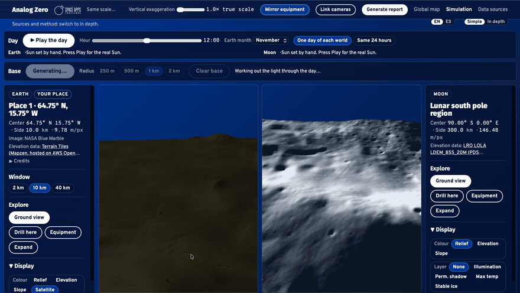
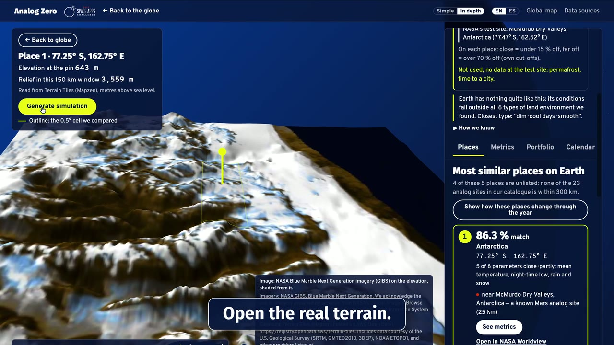
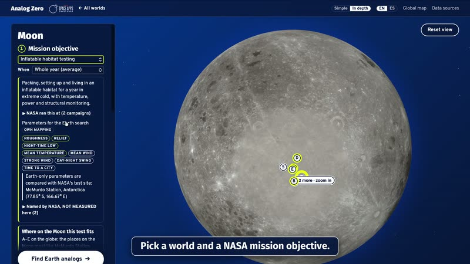
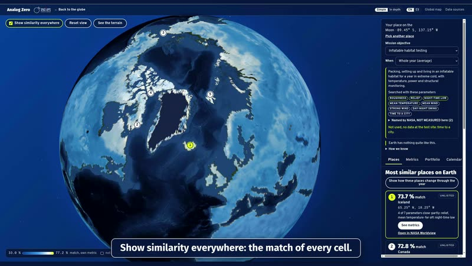
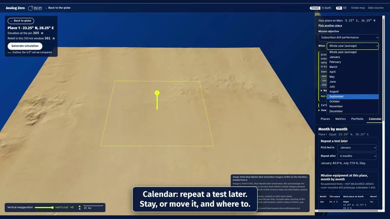
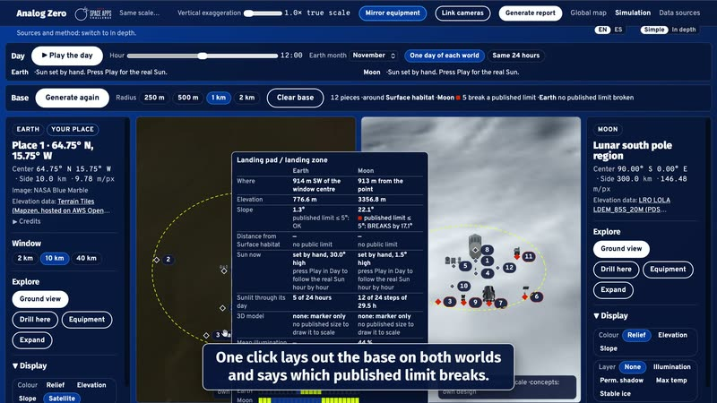
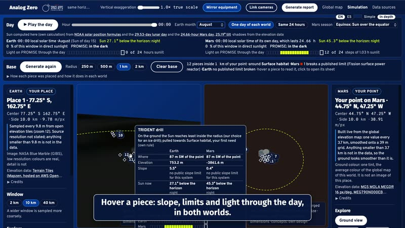
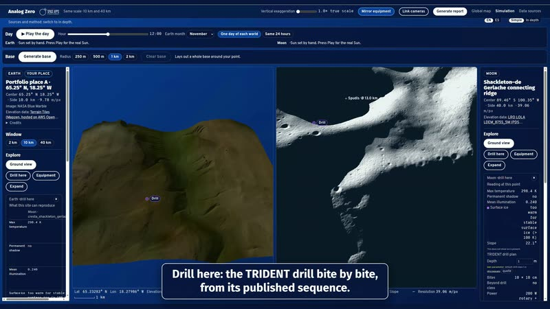
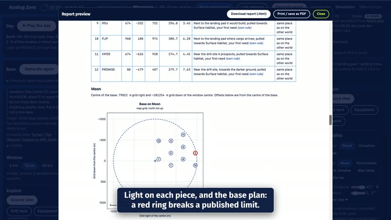

# Analog Zero

**Test here first. Fail here, not there.**

NASA Space Apps Challenge 2026 · Barcelona · challenge «Identify Earth Locations that Analog the Permanent Moon Base Locations and Mars» · team Analog Zero.

Before a base goes to the Moon or Mars, it has to be rehearsed on Earth. Analog Zero searches all of Earth's land for the places most like the spot you choose, says how alike they are parameter by parameter and month by month, and then lets you lay out the same base on both worlds to see which published limit breaks.

[](https://aalexmc.github.io/analog-zero-2026-11-14/media/#clip-4)

**Try it now, in your browser: https://aalexmc.github.io/analog-zero-2026-11-14/** (nothing to install; a computer with a recent browser works best)

**Watch:** [the 30-second pitch](https://aalexmc.github.io/analog-zero-2026-11-14/media/#pitch) · [seven short clips, one per feature](#see-it-in-depth) · **Run it yourself:** [one command, no build](#open-it)

## Where it stands out

1. **An analog is a place and a month.** The same place can match in January and not in July. For Jezero crater on Mars, the best place on Earth is in Canada over the whole year (81.7 %), in Mongolia in January (85.8 %) and in Namibia in July (83.3 %). The Calendar tab says «Stay» or «Move the test», and where to. → [clip 3](https://aalexmc.github.io/analog-zero-2026-11-14/media/#clip-3)
2. **It starts from the mission, not from the map.** You pick one of 21 kinds of test that NASA runs at analog sites. The mission decides which parameters count, and each one shows the NASA campaigns behind it with a literal quotation. → [clip 1](https://aalexmc.github.io/analog-zero-2026-11-14/media/#clip-1)
3. **The search also runs backwards.** Given the Earth site where NASA runs a test, the tool marks the spots A–E on the Moon or Mars that are most like it. → [clip 1](https://aalexmc.github.io/analog-zero-2026-11-14/media/#clip-1)
4. **It looks at the whole Earth, and never gives a single verdict.** Every land cell of a 0.5° grid is compared, not only the famous sites. Each place shows what is close, what is far off and what Earth cannot reproduce. The Portfolio tab gives the fewest places that together cover every parameter; what no place covers goes to a lab. → [clip 2](https://aalexmc.github.io/analog-zero-2026-11-14/media/#clip-2)
5. **The rehearsal happens on both worlds at once.** One button lays out the base on your Earth place and on your Moon or Mars point, at the same offsets, on real terrain. Each piece is checked against its published limits: OK, BREAKS (by how much) or NOT MEASURED. The real Sun of each world moves hour by hour, with terrain shadows. → [clip 4](https://aalexmc.github.io/analog-zero-2026-11-14/media/#clip-4), [clip 5](https://aalexmc.github.io/analog-zero-2026-11-14/media/#clip-5), [clip 6](https://aalexmc.github.io/analog-zero-2026-11-14/media/#clip-6)
6. **It says what it does not know.** Every figure carries its source. Our own choices are labelled «own rule» or «own metric». What we cannot measure says NOT MEASURED. We fixed a validation before looking at the results, it failed, and we show it ([below](#what-it-does-not-do-and-known-limits)).
7. **One click gives the full report.** Parameters, terrain, the Sun hour by hour, the base plan on both worlds, every limit with its verdict and quotation, and the sources, in one self-contained file. → [clip 7](https://aalexmc.github.io/analog-zero-2026-11-14/media/#clip-7)
8. **Anyone can read it.** Every screen has a «Simple | In depth» switch and an «EN | ES» switch. The site is static: nothing to install, no account.

## See it in depth

Every clip is a screen recording of the running app on real data, cut to under 40 seconds. Click a picture to play it on [the videos page](https://aalexmc.github.io/analog-zero-2026-11-14/media/). The files are in `docs/media/`.

| | |
|---|---|
| [](https://aalexmc.github.io/analog-zero-2026-11-14/media/#pitch)<br>**The 30-second pitch.** The challenge, the idea and the whole tour, with voice. | [](https://aalexmc.github.io/analog-zero-2026-11-14/media/#clip-1)<br>**1 · Start from the mission.** Mission objectives on the Moon and on Mars, and the spots A–E where each test fits. |
| [](https://aalexmc.github.io/analog-zero-2026-11-14/media/#clip-2)<br>**2 · The whole Earth, parameter by parameter.** The five closest places, the metrics, the match of every cell and the portfolio. | [](https://aalexmc.github.io/analog-zero-2026-11-14/media/#clip-3)<br>**3 · A place and a month.** The match of each place in each of the 12 months, and the calendar to repeat a test. |
| [](https://aalexmc.github.io/analog-zero-2026-11-14/media/#clip-4)<br>**4 · The base on both worlds.** Rank what the base needs most, lay it out, and see which published limit breaks. | [](https://aalexmc.github.io/analog-zero-2026-11-14/media/#clip-5)<br>**5 · The real Sun, hour by hour.** The day on both worlds with terrain shadows, the sheet of each piece, and the ground view. |
| [](https://aalexmc.github.io/analog-zero-2026-11-14/media/#clip-6)<br>**6 · Equipment and drill.** What you plant on one world appears on the other; the TRIDENT drill bite by bite. | [](https://aalexmc.github.io/analog-zero-2026-11-14/media/#clip-7)<br>**7 · The full report.** Charts, base plan, limits and sources, for the Moon and for Mars. |

## What the challenge asks, and what we do

| The challenge asks | What we do | What we do NOT do |
|---|---|---|
| Go beyond visual likeness | We compare measured layers (terrain, temperature, sunlight, vegetation, rain), not pictures. | No image or texture comparison. |
| Several dimensions | Eight parameters are compared with the Moon or Mars. Eight more exist only on Earth (dryness, wind, permafrost, rock type, travel time to a city…) and are compared with NASA's own test site. | No global layer for dust, subsurface, mineralogy, perchlorates or lava tubes: they are shown as NOT MEASURED. |
| An analog does not have to match everything | Each place shows the deviation of each parameter in %, grouped as close, partly or far off. The portfolio covers the parameters with different places. | No single «best analog» verdict without its parts. |
| Look at the whole Earth, not only the famous sites | All land cells of a 0.5° grid (720 × 360) are searched. A place with none of our catalogue sites within 300 km is labelled «unlisted». | «Unlisted» means outside our own catalogue, not «never studied». |
| Connect with exploration | Mission objectives come from NASA field campaigns, quoted. Base-site criteria come from NASA documents. Equipment limits come from published sources. | We do not plan missions or rank NASA's candidate regions. |
| Recognise the limits of Earth as an analog | Gravity and air pressure are shown for every place as «cannot reproduce». The tool says when a point falls outside every environment type found on Earth. | We do not claim that any Earth place reproduces the Moon or Mars. |

## In numbers

- **720 × 360** cells of 0.5°: every land cell of Earth is compared (`web/data/cuerpos/indice.json`).
- **8** parameters compared with the Moon or Mars, **2** shown as not reproducible on Earth (gravity, air pressure), **8** Earth-only ones.
- **21** mission objectives from NASA campaigns (`web/data/misiones.json`), each with source and literal quotation.
- **13** lunar south-pole systems with their published limits (`web/data/equipo.json`); the base lays out the 12 that stand on the surface.
- **12** months for the parameters that change through the year on Earth.
- **2** worlds (Moon and Mars), **2** languages, **2** reading modes.
- **738** automated tests of the web, and **27** scripts that open every screen in a real browser and check it.
- **0** servers, accounts or build steps: it is a static site.

## Open it

Online: https://aalexmc.github.io/analog-zero-2026-11-14/ (the `web/` folder of this repository, published as it is).

On your own computer:

```
python3 -m http.server 8080 -d web
```

Then open http://localhost:8080. The site is static: no build step, no account and no network needed. The one exception is the local Earth terrain view (`web/relieve/`), which loads map tiles online.

## The tour, in five steps

1. **Pick a world.** The Moon or Mars, on the home page.
2. **Pick a mission objective.** A kind of test NASA runs at Earth analog sites (21 in `web/data/misiones.json`; each world lists only its own), or «New mission» with a title and parameters of your own.
   - **Where the test fits:** spots A–E on the globe are the places on that world most like NASA's Earth test site for the mission, on the parameters that world has measured (the analog search run backwards); the pin goes to A.
   - **When:** next to the mission, a month or the whole year. With a month, or with «Show how these places change through the year», each place shows its match in each of the 12 months (`docs/metrica-analogos.md`, «Meses»).
   - **Calendar** tab: for the chosen place, its match each month, the best place on Earth that month, and the mission's equipment against its published limits. «Repeat a test later» takes a first month and a gap, and says «Stay» or «Move the test», and where to.
3. **Place a point.**
   - Moon: NASA looks within 6° of the south pole, and the tool searches that area on real terrain.
   - Mars: there is no chosen site yet, so the tool uses NASA's published limits for a human landing zone (`web/data/sitio/indice.json`).
   - The tool can propose the best base site by those criteria.
4. **See the places on Earth.** The five most similar places, each with:
   - its deviation per parameter;
   - whether a known analog site is within 300 km;
   - what Earth cannot reproduce (gravity, air pressure).

   The **Portfolio** tab gives the smallest set of places that together cover every parameter; what no place covers has to go to a lab.
5. **Open the terrain.** Real terrain of Shackleton and the south-pole region next to Earth analogs (Haughton, S P Crater, Mistastin), at the same scale. Plant one of 13 lunar south-pole systems (`web/data/equipo.json`): each published limit says OK, BREAKS (by how much) or NOT MEASURED, with its quotation.

   **Generate simulation** (from a place in the results) opens that place on Earth next to the terrain of your point on the Moon or Mars, both seen from above at the same scale and centred on what you chose; **Ground view** stands you on the surface:
   - **Mirror equipment:** what you plant on one world is planted on the other at the same spot of its window; its sheet says what matches, what differs, what cannot be measured and what Earth cannot reproduce.
   - **Day:** one hour slider moves the real Sun of both places (Earth by month; a lunar day of 29.53 Earth days; a Mars day of 24.66 h), with terrain and equipment shadows and a 24-step strip of the light on the equipment.
   - **Generate base:** one button places every surface system of the catalogue (habitat, reactor, landing pad, solar tower, drill, water plant, rovers) inside a radius around your point, each by its own rule and its published limits, on the Moon or Mars and at the same offsets on Earth. Hover a piece to read its slope, limits, Sun and light through the day in both worlds; the reading follows the Day hour. Before placing anything a table lets you rank the pieces: the first one gets the best ground for it and the rest is laid out around it (the pull is our own rule), or you keep the optimal layout with our own order. With a catalogue Moon terrain the base is centred on the point you chose, not on the window.
   - **Generate report:** one button gathers everything the simulation used and found (parameters, terrain statistics, the Sun hour by hour, the light on each piece of the base, the base plan in both worlds, every published limit with its verdict and quotation, similarity parameter by parameter, what is not measured, sources). It opens as a preview, then downloads as one self-contained HTML file or prints to PDF.
   - **Drill here:** the TRIDENT drill bite by bite, from its published sequence and feed speed, and what was already tried on Earth; each line with its quotation.

Every screen can be read in English (default) or Spanish (**EN | ES** switch; source quotations stay in their original language) and has a **Simple | In depth** switch: In depth shows every source, rule and method note; Simple keeps the titles, the main figures, the verdicts and the controls. No figure changes between the two.

Also: a **global map** (`/mapa/`) of where each test condition can be reproduced on Earth, and an exploratory similarity ranking.

## Where every number comes from

- **Data sources** (`/datos/`, link in the top bar): every parameter, on every world, and the dataset it is read from, grouped by NASA Earthdata, Worldview/GIBS, the Planetary Data System and the Lunar Reconnaissance Orbiter. It is read from `web/data/cuerpos/indice.json` and `web/data/sitio/indice.json`.
- **Generated files:** each one carries its own source, URL and licence (`web/data/terreno/*/meta.json`, `web/data/global/capas.json`, `web/data/global/condiciones.json`, `web/data/equipo.json`).
- **Catalogues:** every entry in `datos_json/` (equipment, analog sites, mission objectives) has a source URL and a literal quotation.
- **Our own choices** are labelled as such: «own computation», «own mapping», «own grouping».

## What it does NOT do, and known limits

From `docs/metrica-analogos.md` and `docs/entrega/formulario.md`:
- **Similarity is not a probability.** It depends on which parameters are used and on the reference range: it is not a probability or a physical measure.
- **The validation failed.** The global similarity ranking had a pre-registered validation with thresholds frozen by hash, and it failed: 1 of 11 known analog sites in the best 5 % for their key dimension, where at least 8 were needed (`docs/validacion-global.md`). The ranking stays in the map as exploratory.
- **The environment types are weak.** They are unsupervised (principal components and k-means, no labelled data, no trained model). The silhouette is about 0.3 for every k: land is a continuum and the borders are conventional.
- **Some temperatures are not measurements.** Mars surface temperature is a reanalysis (OpenMARS, 5° grid copied to 0.5°). Earth temperature is a reanalysis too (MERRA-2); the Moon's is a measured brightness temperature (Diviner).
- **No global layer for some conditions:** dust, subsurface, mineralogy, perchlorates, lava tubes. When a NASA source names one of them, it is shown as NOT MEASURED.
- **Gaps in the grid:**
  - Earth has no roughness or relief south of 56° S, so Antarctica is only partly compared.
  - Islands and coasts with less than half land in a 0.5° cell are left out.
- **Fixed targets:** NDVI and rain on the Moon and Mars are 0 by definition. The month only changes Earth: the Moon and Mars keep their yearly value.
- **«Unlisted» is about our catalogue only.** It means none of our catalogue sites is within 300 km, not that nobody has studied the place.

## How it is checked

- `scripts/check.sh` runs the full check and ends with `CHECK_EXIT=<n>`. It needs Python 3.12 with numpy, scipy, rasterio, pyproj, xarray, netCDF4 and pytest; point it to that Python with `AZ_PY=/path/to/python`.
- Web tests only: `node --test web/tests/*.test.mjs` (needs `npm install`).
- Every quotation in the catalogues is looked up in its source: `python scripts/verificar_citas.py` (`--sin-red` uses only the local cache).
- Cast shadows were compared with NASA's average-illumination map: [docs/validacion-sombras](docs/validacion-sombras/README.md).
- The route solver is checked against scikit-image: `python scripts/validar_rutas.py`.
- Screens: `scripts/captura_*.mjs` open each page in a headless browser, check it and save images in `capturas/`. The 30-second demo video is built the same way: `node scripts/video_demo.mjs` → `build/video/`.

## Repository

- `web/`: the static site. `web/data/` is generated by the pipeline.
- `pipeline/`: Python that builds `web/data/` from open data.
- `datos_json/`: catalogues with source and literal quotation.
- `docs/`: data contracts, metric, validation write-ups, submission texts (`docs/entrega/`), and the videos (`docs/media/`).
- `scripts/`: checks, captures and the demo video.

Code identifiers and internal documents are in Spanish; everything on screen is in English, with Spanish as an option.

## Use of AI

The idea, placing the equipment on the analog site and computing what breaks, is the team's own. Large language models (Anthropic Claude, through Claude Code) were used to search and read sources, to write most of the code, tests and catalogues in this repository under the team's direction and review, and to run adversarial reviews of that code. Commits carry a `Co-Authored-By: Claude` trailer. No AI-generated images or video are used: the pictures and clips are captures and screen recordings of the running app on real data. The voice of the 30-second pitch video is a synthetic voice (ElevenLabs) reading a script written by the team.

## Data and credits

- **NASA:**
  - LRO LOLA polar and global elevation models (PDS Geosciences Node);
  - LOLA average illumination and permanently shadowed regions (NASA GSFC PGDA);
  - LRO Diviner (Global Cumulative Products and Polar Resource Product);
  - MGS MOLA (Mars elevation); Mars Odyssey Neutron Spectrometer;
  - NASA POWER; MODIS Terra NDVI (Worldview Snapshots);
  - NSSDC fact sheets;
  - NASA Technical Reports Server documents quoted in the catalogues.
- **USGS:** GMTED2010.
- **ESA / Copernicus:** Copernicus DEM GLO-30 (© DLR e.V. 2010-2014 and © Airbus Defence and Space GmbH 2014-2018, provided under COPERNICUS by the European Union and ESA; all rights reserved); ESA CCI Permafrost v5.0.
- **Other data:**
  - OpenMARS reanalysis (Holmes et al., The Open University, CC BY 4.0);
  - ISRIC SoilGrids 2.0 (CC BY 4.0);
  - GLiM lithology (Hartmann and Moosdorf 2012);
  - Weiss et al. 2018, travel time to cities.
- **Software:** three.js (MIT, copied in `web/lib/three/`), Playwright (tests), scikit-image (route validation only).
