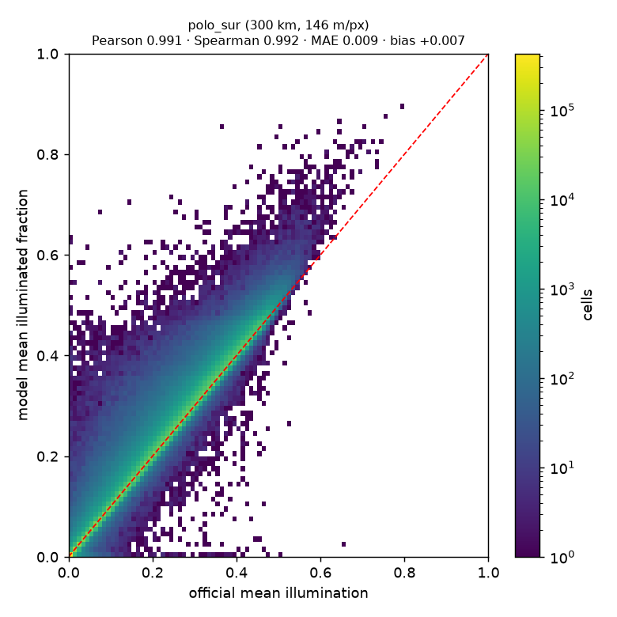
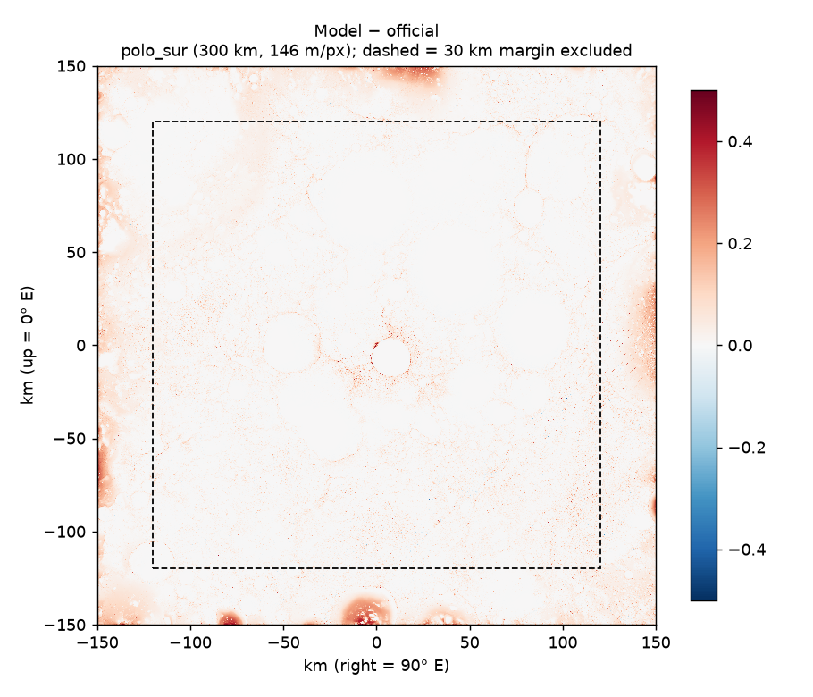

# Shadow model vs NASA's illumination product

Question: if the viewer's cast-shadow code (`web/terreno/calculo.js`) is averaged over every Sun position of a cycle, how close is it to the official LOLA mean-illumination map and permanent-shadow mask?

Protocol fixed before computing: `pipeline/validacion_sombras/PROTOCOLO.md`. Repeat: `node scripts/validar_sombras.mjs` (~20 s). Numbers below are from `web/data/validacion_sombras.json`.

| Terrain | Pearson | Spearman | MAE | Bias (model − official) | PSR precision | PSR recall | PSR IoU |
|---|---|---|---|---|---|---|---|
| `polo_sur`, 300 km, 146 m/px, 30 km margin excluded (main) | 0.991 | 0.992 | 0.009 | +0.007 | 0.923 | 0.967 | 0.895 |
| `polo_sur` inside the `shackleton` footprint | 0.961 | 0.959 | 0.020 | +0.019 | 0.974 | 0.930 | 0.908 |
| `shackleton`, 40 km, 39 m/px, no far horizon (secondary) | 0.833 | 0.787 | 0.082 | +0.076 | 0.966 | 0.898 | 0.870 |

Official product: LOLA `AVGVISIB_85S_060M_201608` and `LPSR_85S_060M_201608` (NASA GSFC PGDA, https://pgda.gsfc.nasa.gov/products/69), hourly over an 18.6-year cycle, Sun as a disc.

What this does not cover:
- A 40 km patch has no far horizon: it comes out too bright (third row). The site view is for looking; illumination numbers come from the official layer.
- The polar average cannot tell a mirrored Sun azimuth from the right one.
- Our DEM is resampled to 146 m (official: 60 m); the model marks slightly more permanent shadow than the official mask. Cause not established.
- Own assumptions: Sun longitude uniform, subsolar latitude ±1.54° as an arcsine distribution, independent; Earth-Moon parallax and librations ignored.

